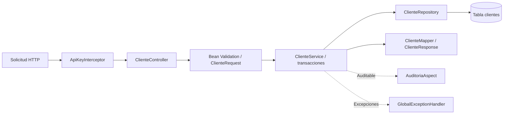
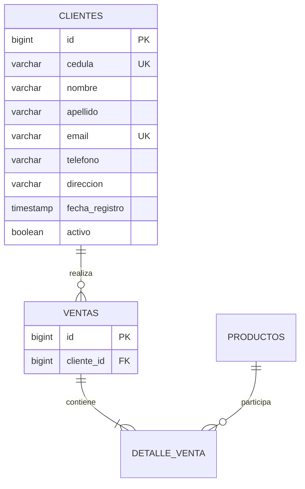

# Módulo de clientes

**Responsable:** Josué Nicolás Muñoz Gualotuña (`jnmunoz2@espe.edu.ec`).
**Grupo:** 9. **Rama:** `feature/clientes`. **Fecha:** 12 de noviembre de 2026.

Repositorio: https://github.com/sgsanchez/ProgAv-TG1-Grupo9

## Alcance y problema

El sistema de ventas necesita identificar a cada cliente, mantener sus datos de contacto y
conservar el historial de facturación. La distribución del equipo en `CONTRIBUTING.md` asigna
a este módulo la entidad Cliente, el CRUD y sus reglas de negocio. Este documento es el aporte
de clientes para integrar en el informe grupal; no sustituye el informe completo ni el video.

Objetivos: administrar clientes mediante HTTP; impedir identidades duplicadas; proteger las
ventas asociadas; verificar las respuestas de éxito y error, y demostrar persistencia.

La base recibida ya contenía entidad, DTOs, mapper, repositorio, servicio y controlador de
clientes. Esta contribución corrige la unicidad del correo frente a diferencias de mayúsculas,
normaliza los correos guardados, recorta el filtro por apellido y amplía las pruebas y evidencias.
No se atribuye a esta contribución la creación de los componentes preexistentes.

## Arquitectura



El controlador recibe solicitudes y construye respuestas; las decisiones de negocio se
mantienen en el servicio. Spring Data JPA ejecuta las consultas. El mapper entrega DTOs para
evitar exponer relaciones JPA y permitir conservar los campos administrados por el servidor.
Las lecturas usan transacciones de solo lectura; las modificaciones usan `@Transactional`.

## Modelo de datos



| Campo | Persistencia | Contrato de entrada |
|---|---|---|
| id | Clave primaria autogenerada | Administrado por el servidor |
| cedula | Única, no nula, varchar(13) | Exactamente 10 dígitos; no comprueba el dígito verificador |
| nombre / apellido | No nulos, varchar(80) | Obligatorios, máximo 80 caracteres |
| email | Único, no nulo, varchar(120) | Obligatorio, formato de correo, máximo 120 caracteres |
| telefono | Opcional, varchar(20) | Si se envía: entre 7 y 10 dígitos; puede omitirse o ser null |
| direccion | Opcional, varchar(200) | Máximo 200 caracteres |
| fecha_registro | No nula | Se asigna al insertar; PUT la conserva |
| activo | No nulo, true inicialmente | PUT conserva el valor actual |

`ventas.cliente_id` referencia `clientes.id`. La relación no tiene eliminación en cascada.
La longitud física de cédula permite 13 caracteres, pero la API admite 10 según el DTO existente.

## Endpoints

Todas las rutas requieren `X-API-KEY`; en desarrollo el valor predeterminado es `grupo9-2026`.

| Método | Ruta | Éxito | Errores principales |
|---|---|---|---|
| GET | `/api/clientes` | 200, lista | 401 sin clave válida |
| GET | `/api/clientes?apellido=per` | 200, coincidencia parcial sin distinguir mayúsculas | 401 |
| GET | `/api/clientes/{id}` | 200 | 404 inexistente, 400 ID no numérico |
| POST | `/api/clientes` | 201 y cabecera Location | 400 validación, 409 duplicado |
| PUT | `/api/clientes/{id}` | 200 | 400 validación, 404 inexistente, 409 duplicado |
| DELETE | `/api/clientes/{id}` | 204 sin cuerpo | 404 inexistente, 409 con ventas |

Ejemplo para POST y PUT (datos ficticios):

```json
{
  "cedula": "1800000099",
  "nombre": "Ana",
  "apellido": "Perez",
  "email": "demo.cliente@example.com",
  "telefono": "0991234567",
  "direccion": "Quito"
}
```

## Reglas y manejo de errores

1. No se permite repetir una cédula.
2. El correo es único sin distinguir mayúsculas: `ANA@example.com` y `ana@example.com`
   representan el mismo contacto para este sistema. Los nuevos correos se guardan en minúsculas
   usando `Locale.ROOT`; la búsqueda también detecta datos antiguos con mayúsculas.
3. Al actualizar, se excluye el propio ID de la verificación de correo. Conservar la cédula
   y el correo propios es válido; apropiarse de los de otro cliente devuelve 409.
4. No se elimina un cliente con ventas, aunque todas estén anuladas: se conserva el historial.
5. La actualización no cambia ID, fecha de registro ni estado activo.
6. Los campos obligatorios y sus tamaños se validan antes de persistir.

`RecursoDuplicadoException` y `ReglaNegocioException` se convierten en 409;
`RecursoNoEncontradoException`, en 404. Bean Validation produce 400. El manejador central
responde con `timestamp`, `status`, `error`, `mensaje`, `ruta` y `detalles`.

Las restricciones únicas de la base complementan las comprobaciones del servicio frente a
solicitudes simultáneas. La normalización protege las escrituras realizadas por esta API;
una importación SQL externa que eluda el servicio deberá normalizar correos y depurar posibles
duplicados históricos. No se ejecuta una migración destructiva sobre datos existentes.

## Middleware, aspecto y ejecución bloqueante

El interceptor preexistente valida la clave antes de llegar al controlador. El aspecto existente
registra las operaciones anotadas de crear, actualizar y eliminar; se consulta en `/api/auditoria`.
Las evidencias muestran respuestas 401 y registros de auditoría tanto exitosos como fallidos.

Las consultas JPA/JDBC del módulo son bloqueantes: el hilo espera a la base de datos.
El proyecto cuenta con una alternativa asíncrona para comprobantes en `ComprobanteService`,
mediante `@Async` y `CompletableFuture`. Esto descarga trabajo a otro pool, pero no convierte
JDBC en reactivo. Esa funcionalidad pertenece al proyecto integrado, no a esta modificación.

## Verificación reproducible

Desde la raíz del repositorio, con Java 21:

```powershell
.\mvnw.cmd -B -ntp verify
python scripts/demo-clientes.py --output target/clientes-http.json
```

La segunda orden requiere Python 3. Usa únicamente su biblioteca estándar. Inicia el JAR en
un puerto local libre y una base H2 en disco temporal, ejecuta solicitudes HTTP reales, detiene
Java, lo inicia otra vez, consulta el dato persistido y elimina el cliente de prueba. No usa
la base de desarrollo del grupo. Al terminar, detiene el proceso y limpia la base temporal.

Resultado local del 12/11/2026: **69 pruebas, 0 fallos, 0 errores y 0 omitidas**. De ellas,
**18 casos nuevos** pertenecen a `ClientesIntegracionTest`: normalización y CRUD; correos
duplicados con tres variantes; cédula repetida; conflicto en actualización; eliminación
protegida en los tres estados de venta; filtro con espacios; inexistencia; seis campos
inválidos; y rechazo del interceptor. Las pruebas usan H2 y verifican recargas desde JPA.

La demostración HTTP conserva respuestas reales en [clientes-http.json](evidencias/clientes-http.json).
Esta evidencia comprueba H2 persistente, no constituye una ejecución contra PostgreSQL.
El perfil PostgreSQL debe validarse también en el entorno de integración del grupo.

## Pipeline y resultados

El workflow `.github/workflows/ci.yml` se ejecuta para ramas `feature/**` y solicitudes hacia
`develop`. Obtiene el código, configura Java 21, ejecuta `clean verify` y publica los reportes
Surefire. Por ello incorpora automáticamente las nuevas pruebas. Es integración continua;
no se afirma que despliegue automáticamente la aplicación.

La corrección evita clientes duplicados por capitalización del correo y mantiene el contrato
HTTP existente. El filtro por apellido tolera espacios externos. Las pruebas muestran que la
actualización conserva metadatos y que no se puede destruir el historial de ventas.

## Guion de defensa individual (aproximadamente 3 minutos)

| Tiempo | Explicación y demostración |
|---|---|
| 0:00-0:30 | Presentarse y explicar la responsabilidad del módulo de clientes |
| 0:30-1:05 | Recorrer Controller → Service → Repository; mostrar relación Cliente-Venta |
| 1:05-2:10 | Crear, consultar, actualizar y eliminar; demostrar duplicado 409 y validación 400 |
| 2:10-2:40 | Mostrar la consulta después del reinicio y la evidencia de auditoría |
| 2:40-3:00 | Explicar las pruebas y mostrar los commits y el resultado del pipeline |

Para la grabación, mantener cámara y micrófono encendidos. El video grupal tiene un máximo
de 15 minutos y todos deben intervenir. El enlace del video va como comentario en la entrega;
el grupo debe verificar su reproducción sin iniciar sesión.

## Conclusiones y trabajo futuro

La separación por capas permite corregir la regla de unicidad sin introducir lógica en el
controlador. La combinación de pruebas de integración y solicitudes HTTP tras reiniciar el
proceso aporta evidencia del comportamiento y la persistencia. Como mejoras futuras:
paginación de clientes, validación de dígito verificador si el grupo la acuerda, migración
controlada de correos históricos y ejecución de esta cobertura sobre PostgreSQL.

El informe final `TallerGrupal1_Grupo9.pdf` debe integrar las partes de los cuatro integrantes,
sus índices, diagramas, evidencias y referencias. Este aporte no acredita la grabación del
video ni la entrega en el aula virtual. Los commits conservan sus fechas reales.

## Referencias

- Enunciado: Proyecto Grupal Unidad 1, Programación Avanzada, ESPE, 2026 (documento de la actividad).
- Distribución del equipo y código: [repositorio del Grupo 9](https://github.com/sgsanchez/ProgAv-TG1-Grupo9).
- Componentes consultables en el código: `ClienteController`, `ClienteService`, `ClienteRepository`,
  `Cliente`, `ClienteRequest`, `ClienteMapper`, `GlobalExceptionHandler` y `ClientesIntegracionTest`.
